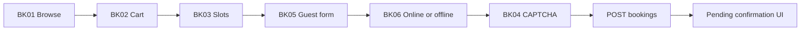

# Lovable Frontend Guide — BraidsByChi

Paste this brief into Lovable (or sync the repo and point Lovable at this file). Build the **client booking site** and **stylist admin dashboard** against the Railway Django API. Do not invent business rules that contradict the docs below.

---

## 1. Role & constraints

### Product
Guest-only online booking for a single independent hair stylist (BraidsByChi). Clients have **no accounts**. Every booking is a **request** that stays `pending` until the stylist approves or declines — this is **not** instant book.

### What you build
- Public booking site (browse → cart → slots → details → payment → submit)
- Guest self-service via secure email link (`/manage/:token`)
- Admin dashboard (TOTP login, calendar, approve/decline, availability, services, arrival/no-show)

### Stack
- React + Vite (Lovable default) → deploy to **Vercel**
- Talk **only** to the Railway backend API (`VITE_API_BASE_URL`)
- Payments: **Stripe.js** (Setup Intent at submit; capture happens on server at approval)
- CAPTCHA: hCaptcha or Cloudflare Turnstile site key in the browser
- PWA (manifest + icons) is frontend-only polish — do last

### Hard rules — do not violate
- **Never** put Supabase secret keys, Stripe secret keys, or Resend keys in the frontend
- **Never** write `clients` / `bookings` / `admin_auth` directly from the browser — all writes go through the API
- **Never** treat a successful `POST /api/bookings` as a confirmed appointment — status is `pending`
- **Never** show `calendar_blocked_until` (buffer end) to clients
- **Never** include the 30-minute buffer in `required_duration_minutes` when fetching slots
- **Never** send duration or end time on `POST /api/bookings` — the backend computes them
- **Never** invent deposit threshold, tax lines, surcharge disclosure copy, or admin session timeout — those are open product decisions

### Canonical docs (read in this order when unsure)
1. `01-prd-updated.md` — product decisions
2. `04-workflows-and-simulations.md` — step-by-step scenarios
3. `06-api-contracts.md` — request/response shapes (authoritative)
4. `05-error-messages.md` — user-facing copy
5. `03-features-catalog.md` — feature IDs (BK-*, PM-*, etc.)
6. `02-data-model-schema.md` — field meanings / status enums
7. `07-tech-stack-and-file-structure.md` — IA / folder hints
8. `08-env-template.md` — env vars
9. `09-build-plan-phases.md` — dependency order

Domain deep-dives (same repo): `BK-booking-flow.md`, `PM-payments-deposits.md`, `ST-strike-risk-system.md`, `AV-availability-scheduling.md`, `AU-admin-auth.md`, `AD-admin-dashboard.md`, `GS-guest-self-service.md`, `NT-notifications.md`.

---

## 2. Non-negotiable frontend rules

| Topic | Rule |
|---|---|
| Timestamps | ISO 8601 **UTC on the wire**. Display in **`America/Regina`** (CST, no DST). |
| Money | CAD, two decimal places. After submit, display **`amount_due_today`** — not a client-side recompute of deposit. |
| Pagination | List endpoints return `{ count, next, previous, results }`. Read **`results`**. Follow `next` / `previous` URLs as given (or `?page=N`). Page size 20. |
| Buffer (AV-06) | Global 30 min, applied once at end of appointment. Backend adds it. Clients never see it. Admin calendar **may** show buffer as a lighter/hatched strip after the solid service block. |
| Slot duration input | `required_duration_minutes` = **sum of selected services’ `duration_minutes` only** (e.g. 180, not 210). |
| Client-facing end time | Always show **`service_end_time`**. Never show `calendar_blocked_until` on public UI or guest emails-facing summaries. |
| Errors | Shape: `{ "error": { "code": "...", "message": "..." } }`. Map codes to copy in `05-error-messages.md`; do not expose stack traces or Stripe raw codes. |
| Auth | Public routes: unauthenticated (rate-limited server-side). Admin: `session_token` from TOTP or backup-code login on every `/api/admin/*` call (except login). |
| Staging | When env is staging, show a persistent **“STAGING — not live”** banner on every admin page. |
| Day of week | API uses **0 = Monday … 6 = Sunday** (Python/ISO). Align calendar libraries that default to Sunday=0. |
| Services | No deposit fields on service create/edit — deposit is booking-level only. |
| Bookings | Soft-archive only — no hard delete of bookings from the UI. |

---

## 3. App surfaces & routes

**Preferred shape:** one Lovable app — public routes + `/admin/*` gated by session. (Separate admin deploy is allowed later; don’t block on it.)

### Public
| Route | Feature | Purpose |
|---|---|---|
| `/` | BK-01 | Category & service browse |
| `/book/cart` | BK-02 | Multi-service cart |
| `/book/slots` | BK-03 | Availability slot picker |
| `/book/details` | BK-05 | Guest name / email / phone + policy checkbox |
| `/book/payment` | BK-06, PM-01, ST-06 | Online vs offline; Stripe Elements if online; strike warning |
| `/book/confirm` | BK-05 | Post-submit pending confirmation (not “booked”) |
| `/manage/:token` | GS-01, GS-02 | Guest cancel / reschedule via secure link |
| `/terms` | Policy | Linked from policy checkbox |
| `/privacy` | Policy | |
| `/cancellation-policy` | Policy | |

### Admin
| Route | Feature | Purpose |
|---|---|---|
| `/admin/login` | AU-02, AU-03 | TOTP + backup-code fallback |
| `/admin` | AD-01, BK-09, AD-03 | Calendar / list, conflicts, archive filter |
| `/admin/bookings/:id` | BK-08, PM-05, PM-06, AD-04 | Approve / decline / proof / override / arrival |
| `/admin/availability` | AV-01…AV-04 | Weekly hours, block day, resolution queue |
| `/admin/services` | AD-05 | Services + categories CRUD |
| `/admin/clients/:id` | AD-06, ST-04 | Strike / high-risk view + clear flag |

---

## 4. Client booking wizard (step contracts)



### Step A — Browse (BK-01)
- **API:** `GET /api/categories` (paginated)
- **UI:** categories ordered by `display_order`; each nested `services[]` with name, photo, price, `duration_minutes`
- **Note:** nested services are not separately paginated; only the category list is

### Step B — Cart (BK-02)
- Client state only until submit: selected `service_ids[]`
- Show running **combined price** and **combined duration** (sum of `duration_minutes`)
- 2+ services = multi-service for deposit display hints; still **do not** treat cart math as the charge amount after API responds
- Optional deposit *preview* before submit is OK for UX; after submit, trust the API

### Step C — Slots (BK-03)
- **API:** `POST /api/availability/slots`
```json
{
  "date_from": "YYYY-MM-DD",
  "date_to": "YYYY-MM-DD",
  "required_duration_minutes": 180
}
```
- `required_duration_minutes` = cart duration sum **without** buffer
- Response: `{ "slots": [ { "start", "service_end_time" } ] }` — each item is a single-day option
- Group by local date for calendar UI
- Display each option as local start–end using `start` and `service_end_time` only

### Step D — Guest details (BK-05)
- Fields: name, email, phone
- Checkbox: agree to Terms & Cancellation Policy (`policy_acknowledged` must be `true` to submit)
- Copy if unchecked: see `05-error-messages.md`

### Step E — Payment choice (BK-06) + CAPTCHA (BK-04)
- **Online:** Stripe Elements / Setup Intent via Stripe.js → obtain `stripe_setup_intent_id`. **No charge at submit.**
- **Offline:** no card UI; explain that stylist must confirm payment before approval
- CAPTCHA widget → `captcha_token` on submit
- If API later returns `strike_warning: true` (or you surface ST-06 from response before payment step completes), show inline warning: next missed appointment requires full payment upfront (see `05-error-messages.md` / Workflow 3)

### Step F — Submit
- **API:** `POST /api/bookings`
```json
{
  "client": { "name": "...", "email": "...", "phone": "..." },
  "service_ids": ["uuid"],
  "requested_start_time": "2026-08-25T14:00:00Z",
  "payment_method": "online",
  "policy_acknowledged": true,
  "captcha_token": "...",
  "stripe_setup_intent_id": "... if online"
}
```
- Response fields that matter for UI:
  - `status`: expect `"pending"`
  - `service_end_time` — show appointment end
  - `amount_due_today` — what will actually be charged/collected
  - `deposit_amount` — informational; do **not** prefer this over `amount_due_today`
  - `full_payment_required` — high-risk path
  - `strike_warning` — show banner when true
- Do **not** send duration/end/buffer fields
- Known error codes: `slot_unavailable`, `captcha_failed`, `policy_not_acknowledged`, `card_verification_failed`, `high_risk_full_payment_required`

### Step G — Confirm screen
- Success copy: **"Your request has been sent! You'll receive an email once it's reviewed."**
- Do **not** say “confirmed” / “booked”

### Acceptance scenarios (client)
Implement and manually verify against `04-workflows-and-simulations.md`:
- **Workflow 1** — single service, online, pending → (admin) approve
- **Workflow 2** — multi-service cart, combined duration, multi deposit path
- **Workflow 3** — strike warning at 1 strike; full payment UI when high-risk
- **Workflow 4** — offline path, no Stripe UI

---

## 5. Guest self-service (`/manage/:token`)

| Action | API | Notes |
|---|---|---|
| Load booking | `GET /api/bookings/:token` | Token ≠ booking UUID; possession of token is auth |
| Cancel | `POST /api/bookings/:token/cancel` | Respect cutoff messaging |
| Reschedule | `POST /api/bookings/:token/reschedule` body `{ "new_start_time": "..." }` | Pick new slot via same BK-03 slots API |

- On `reschedule_limit_reached`: use copy from `05-error-messages.md` (cancel + new request)
- Past cutoff: block or warn per catalog — cannot silently bypass strike rules
- **Workflow 8** is the acceptance scenario for reschedule limit

---

## 6. Admin dashboard (step contracts)

### Login (AU-02 / AU-03)
- Primary: `POST /api/admin/login` `{ "totp_code": "123456" }` → `{ session_token, expires_at }`
- Fallback: `POST /api/admin/login/backup-code` `{ "backup_code": "..." }`
- Persist `session_token`; send on all other admin requests (header convention as implemented by backend — typically `Authorization: Bearer <token>` or session header; match API)
- Rate-limit / invalid-code copy from `05-error-messages.md`
- Staging banner if staging env

### Bookings calendar / list (AD-01, AD-03, BK-09)
- **API:** `GET /api/admin/bookings?status=pending&include_archived=false&page=1`
- Use `results[]`; show `conflict_flag` badge when true
- Calendar blocks: solid = `requested_start_time` → `service_end_time`; hatched = through `calendar_blocked_until`
- Default exclude archived; toggle `include_archived=true` for archive view
- Pending ≠ approved visually — attention queue for pending + conflicts

### Booking detail actions
| Action | API | UI gate |
|---|---|---|
| Approve (online) | `POST /api/admin/bookings/:id/approve` | Confirm if conflicts (auto-declines others) |
| Approve (offline) | same, body `{ proof_url, proof_note }` | **Disable Approve** until proof fields present (PM-05) |
| Decline | `POST /api/admin/bookings/:id/decline` `{ reason? }` | Reason optional |
| Batch | `POST /api/admin/bookings/batch` `{ booking_ids, action }` | Handle per-ID failures / mixed status |
| Arrival | `POST /api/admin/bookings/:id/arrival` | `arrived` free; `no_show` **requires note** |
| Manual override | `POST /api/admin/bookings/:id/manual-override` `{ note }` | Note **required** (payment_failed path) |

### Availability (AV-01…AV-04)
- Prefer **`PUT /api/admin/availability/recurring/bulk`** for the weekly hours form (full replace — days omitted are removed)
- Also available: GET/POST/PATCH/DELETE single recurring rules
- Block: `POST /api/admin/availability/block` `{ date, reason }` → may return `conflicts[]`; day blocks immediately
- Resolution queue: `GET /api/admin/availability/resolution-queue` (paginated)

### Services & categories (AD-05)
- Admin list/CRUD: `/api/admin/services`, `/api/admin/categories` (see API checklist)
- **No** deposit fields on forms
- Price/duration edits do not rewrite historical `booking_items`

### Clients (AD-06, ST-04)
- Show strike_count, high_risk_flag, reschedule history as returned by API
- Clear high-risk: `POST /api/admin/clients/:id/clear-high-risk` `{ note? }`

### Acceptance scenarios (admin / guest)
- **Workflow 5** — block day with approved booking → conflicts → resolution queue
- **Workflow 6** — concurrent pending same slot → conflict badges → approve one
- **Workflow 7** — expired pending shown correctly if listed
- **Workflow 8** — guest reschedule limit (manage link)

---

## 7. API client checklist

Full shapes: **`06-api-contracts.md`**. Implement these from the frontend.

### Public
| Method | Path | Feature | Do not |
|---|---|---|---|
| GET | `/api/categories` | BK-01 | Treat body as bare array — use `results` |
| POST | `/api/availability/slots` | BK-03 | Add buffer into `required_duration_minutes` |
| POST | `/api/bookings` | BK-05/06, PM-01 | Send end time / buffer; call success “confirmed” |
| GET | `/api/bookings/:token` | GS / NT-03 | Use booking UUID instead of token |
| POST | `/api/bookings/:token/cancel` | GS-01 | |
| POST | `/api/bookings/:token/reschedule` | GS-02/03 | Ignore `reschedule_limit_reached` |

### Admin (session required)
| Method | Path | Feature | Do not |
|---|---|---|---|
| POST | `/api/admin/login` | AU-02 | |
| POST | `/api/admin/login/backup-code` | AU-03 | |
| GET | `/api/admin/bookings` | AD-01/03 | Hide `calendar_blocked_until` from stylist calendar |
| POST | `/api/admin/bookings/:id/approve` | BK-08, PM-03/05 | Approve offline without proof |
| POST | `/api/admin/bookings/:id/decline` | BK-08 | Require reason (it is optional) |
| POST | `/api/admin/bookings/batch` | AD-02 | Assume all IDs succeed |
| POST | `/api/admin/bookings/:id/arrival` | AD-04 | Allow no-show without note |
| POST | `/api/admin/bookings/:id/manual-override` | PM-06 | Allow empty note |
| POST | `/api/admin/clients/:id/clear-high-risk` | ST-04 | |
| GET/POST/PATCH/DELETE | `/api/admin/availability/recurring`… | AV-01 | Confuse Sunday=0 JS libs with API Monday=0 |
| PUT | `/api/admin/availability/recurring/bulk` | AV-01 | Merge silently — bulk **replaces** week |
| POST | `/api/admin/availability/block` | AV-02/03 | |
| GET | `/api/admin/availability/resolution-queue` | AV-04 | |
| GET/POST/PATCH/DELETE | `/api/admin/services`… | AD-05 | Add deposit fields |
| GET/POST/PATCH/DELETE | `/api/admin/categories`… | AD-05 | |

### Not frontend
| Path | Note |
|---|---|
| `POST /api/webhooks/stripe` | Backend only |

---

## 8. Env vars (Lovable / Vercel)

Set these in Lovable/Vercel. Never commit secrets.

```bash
VITE_API_BASE_URL=https://<railway-api-host>
VITE_STRIPE_PUBLISHABLE_KEY=pk_test_xxx
VITE_CAPTCHA_SITE_KEY=
VITE_PUBLIC_SITE_URL=https://braidsbychi.app.ekanets.com
VITE_APP_ENV=staging
```

- `VITE_APP_ENV=staging` → show admin staging banner
- Backend owns: Stripe secret, webhook secret, Supabase secret, Resend, CAPTCHA secret, TOTP secrets, deposit threshold env
- CORS: Railway must allow the Lovable/Vercel origin (`CORS_ALLOWED_ORIGINS`)

See `08-env-template.md` for the full project list.

---

## 9. Build order (Lovable phases)

Align with frontend slices of `09-build-plan-phases.md`:

1. **Foundation** — API client, pagination helper, timezone util (`America/Regina`), error mapper, routing shell
2. **Browse** — BK-01 categories/services
3. **Cart + slots** — BK-02, BK-03
4. **Guest submit** — BK-04, BK-05, BK-06, Stripe Setup Intent UI (PM-01), pending confirm screen
5. **Manage-by-token** — GS-01, GS-02, GS-03
6. **Admin auth + bookings** — AU-02/03, AD-01, BK-08 approve/decline, conflict badges
7. **Availability + catalog admin** — AV-01 bulk schedule, AV-02 block, AD-05 services/categories
8. **Ops depth** — AD-02 batch, AD-04 arrival, PM-05 offline proof gate, PM-06 override, AV-04 resolution queue, ST-04/ST-06 high-risk UI
9. **PWA polish** — manifest, icons, installability (`system-notes.md`)

Do not fake high-risk full-payment until the API returns `full_payment_required` / `amount_due_today` correctly.

---

## 10. Definition of done

- [ ] Workflows **1–4** work end-to-end on the public site (against staging API)
- [ ] Workflows **5–6** work on admin (block+resolution, conflict approve)
- [ ] Workflow **8** works on `/manage/:token`
- [ ] Client UI never shows buffer / `calendar_blocked_until`
- [ ] Successful submit says **request sent / pending**, never confirmed
- [ ] Offline approve requires proof fields before enable
- [ ] No-show and manual override require notes in UI (backend will reject otherwise)
- [ ] Paginated lists use `results` + next/previous
- [ ] All money displays use CAD; post-submit charge label uses `amount_due_today`
- [ ] Times display in America/Regina
- [ ] Error codes map to `05-error-messages.md` copy
- [ ] Staging banner on admin when `VITE_APP_ENV=staging`
- [ ] No secret keys in the Lovable project

---

## Prompt snippet (optional — paste into Lovable chat)

```
You are building the BraidsByChi frontend (React + Vite): public guest booking + /admin dashboard.
Follow docs/lovable-frontend-guide.md strictly. API contracts are in docs/06-api-contracts.md.
Request-based booking only — POST /api/bookings creates pending, not confirmed.
UTC on wire, display America/Regina. Never send buffer in slot duration. Never show calendar_blocked_until to clients.
Use amount_due_today for charge display. Paginated lists use response.results.
Build in the phase order in the guide. Do not invent tax/surcharge/deposit-threshold behavior.
```
